# Informe 01 · Faro Hundido está completo (con arte provisional)

**Fecha:** 26 de octubre de 2026 · **Estudio:** TopinGames (Xiombo) · **Plataformas:** Android y PC

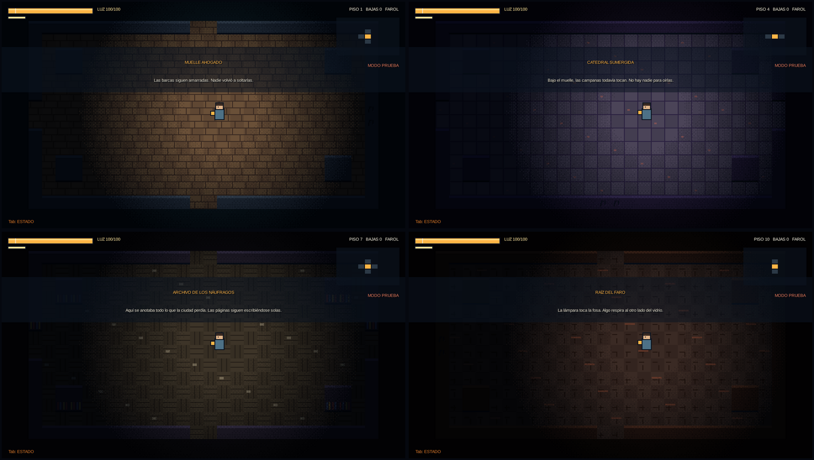

## Resumen en 30 segundos

Faro Hundido es un roguelike de acción: una isla se hunde, el faro es la única luz que queda y cada partida es una bajada más profunda. **El juego ya se puede terminar de principio a fin.** Lo que falta es lo que más se ve: el arte final en 32 bits. Las capturas de este informe son del arte provisional (rectángulos y formas simples), a propósito: es el "antes" de la historia.

**Qué hay hoy:**
- 4 biomas: Muelle Ahogado, Catedral Sumergida, Archivo de los Náufragos y Raíz del Faro.
- 5 jefes: la Sirena, el Obispo, el Cartógrafo, la Lámpara Madre y el Farero Antiguo del final secreto, más la criatura de la Marea 10.
- 3 finales distintos.
- 10 Mareas (niveles de dificultad que se acumulan al ganar).
- Santuario con tienda, mejoras permanentes y 4 náufragos con historia.
- Pantalla de Estado para ver cuánto mejora cada compra.
- Música y efectos propios.
- Demo jugable para quienes apoyen la campaña, con instalador para Windows y APK firmada.

## Galería (para usar en publicaciones)

| | |
|---|---|
| 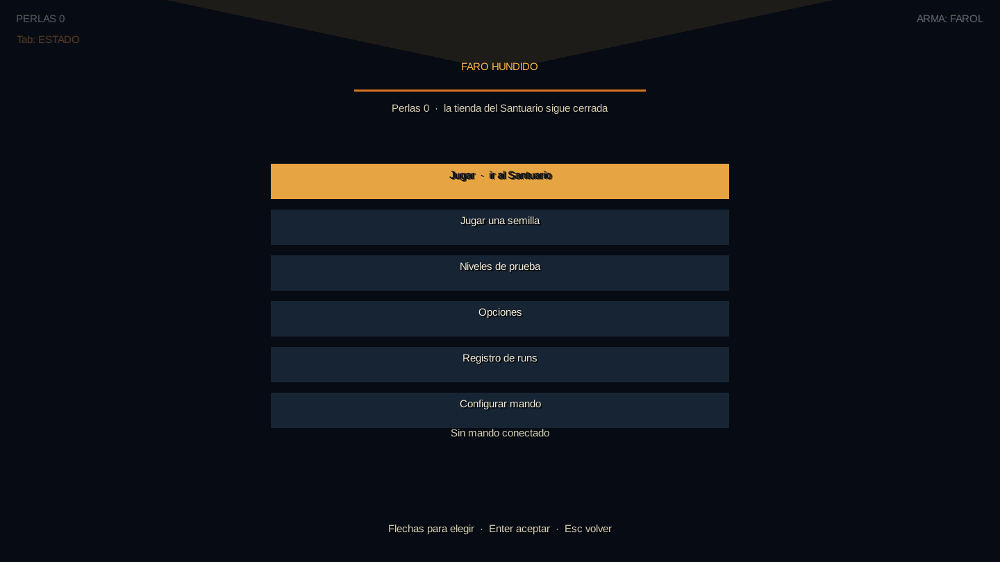 Menú principal | 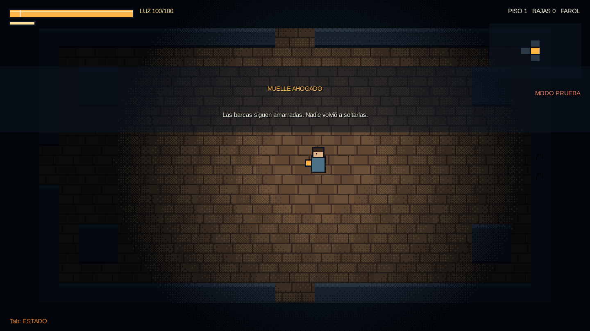 **Muelle Ahogado:** "Las barcas siguen amarradas. Nadie volvió a soltarlas." |
| 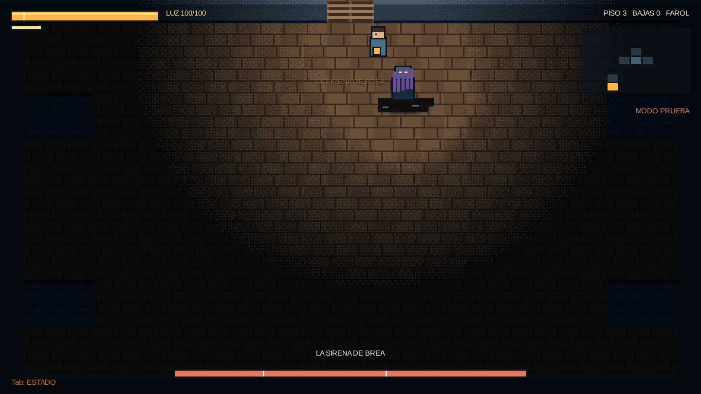 **La Sirena de Brea**, primer jefe | 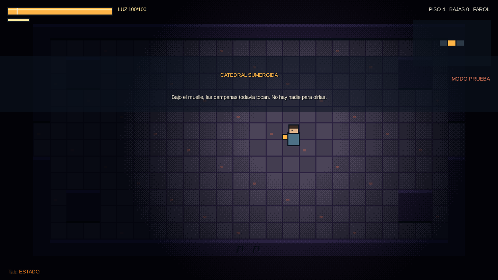 **Catedral Sumergida:** "Las campanas todavía tocan." |
| 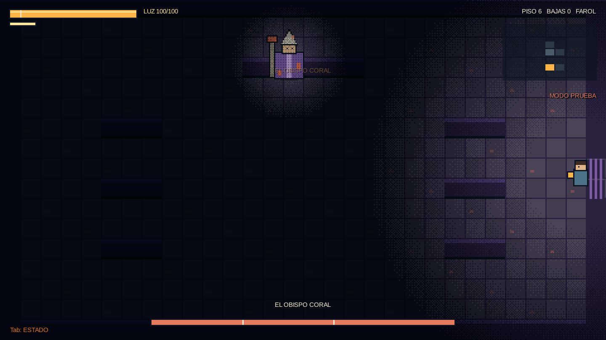 **El Obispo Coral** | 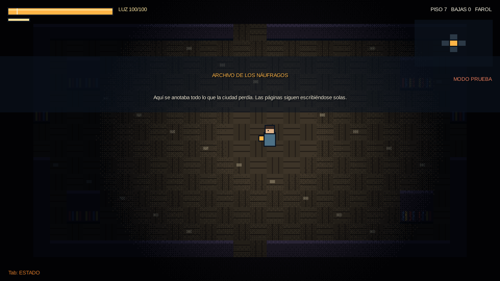 **Archivo de los Náufragos** |
| 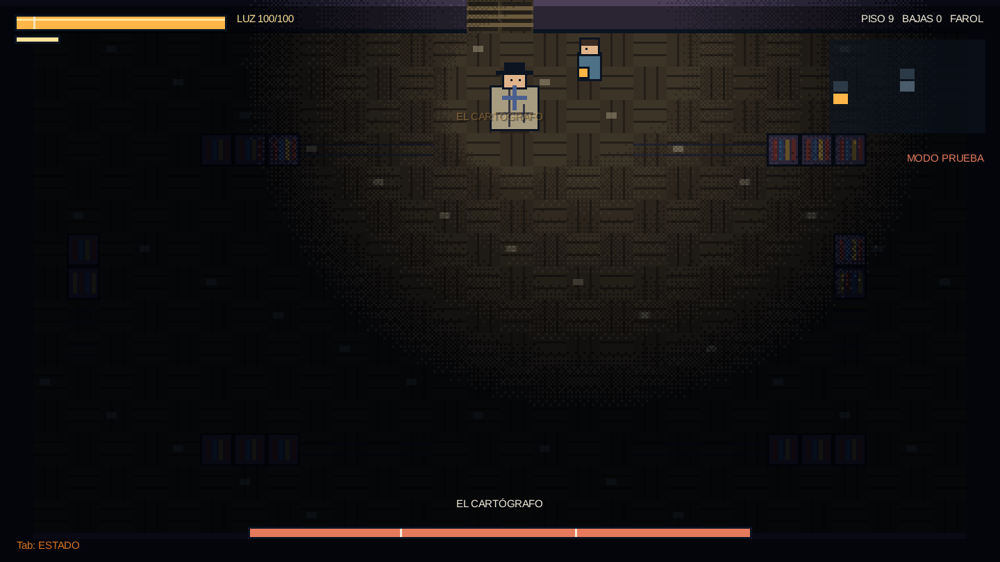 **El Cartógrafo** | 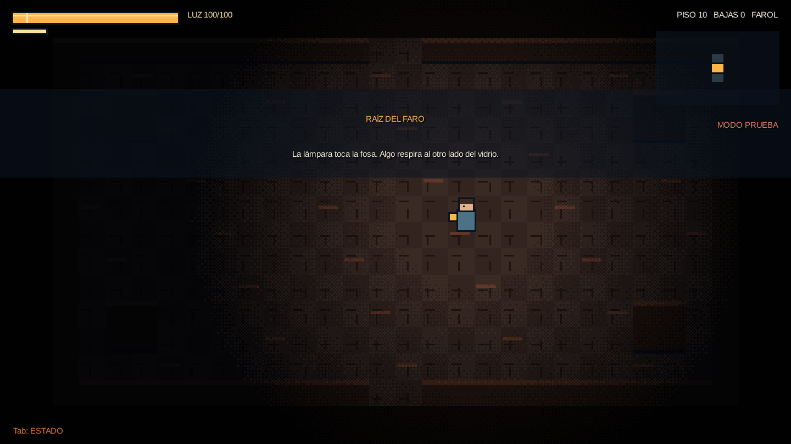 **Raíz del Faro:** "Algo respira al otro lado del vidrio." |
| 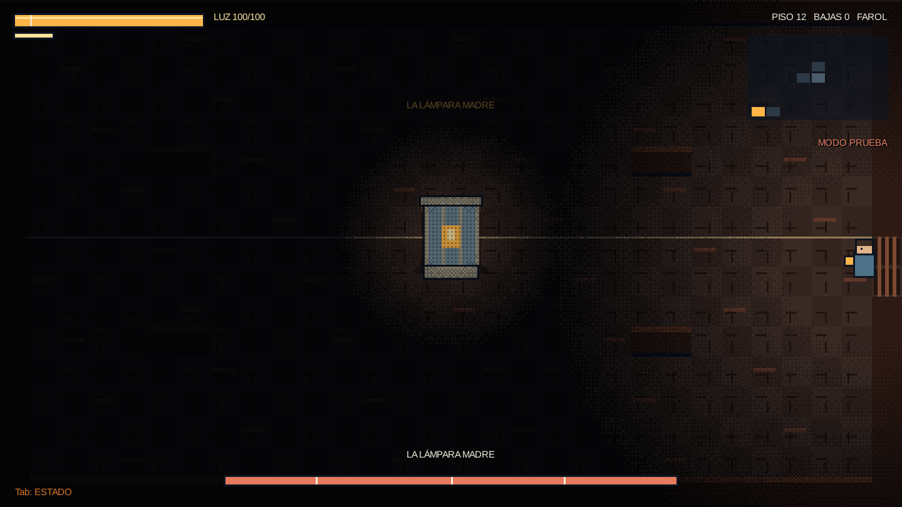 **La Lámpara Madre**, jefe final | 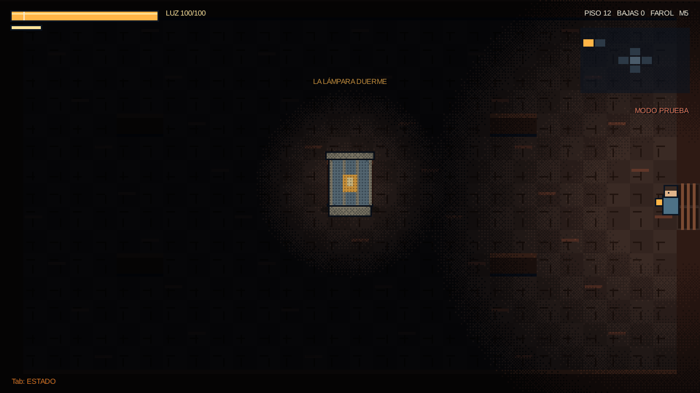 **Lámpara dormida** (Marea 5): final secreto C |
| 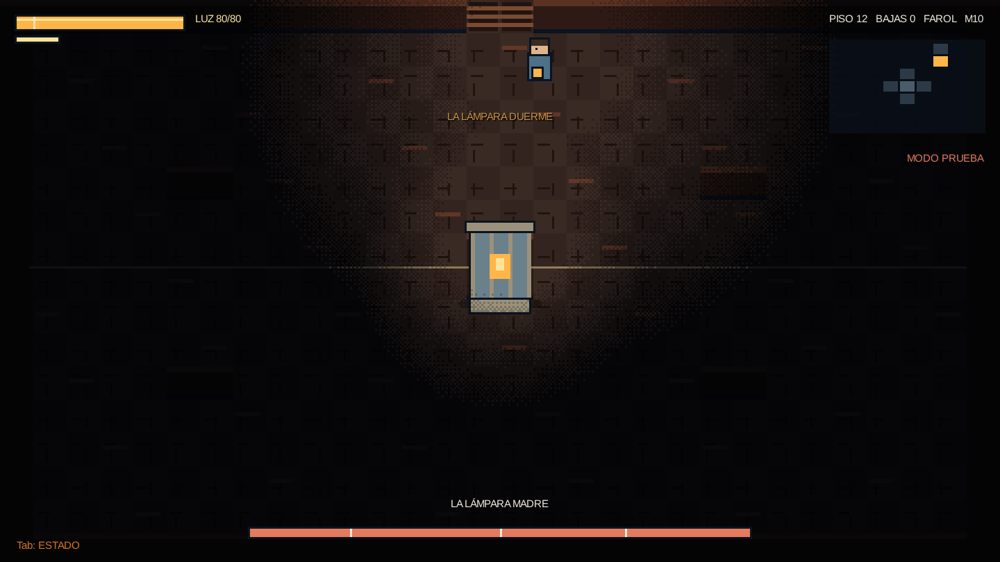 **Marea 10:** la criatura | 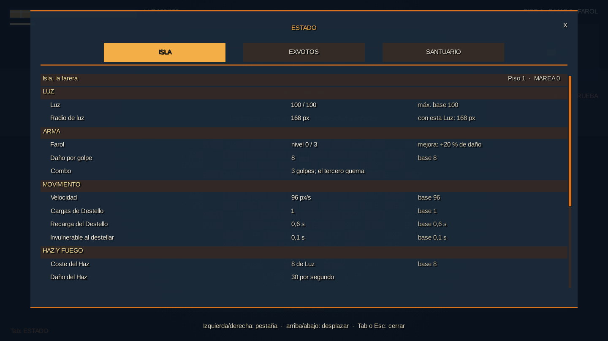 **Pantalla de Estado:** cada mejora comparada con su valor base |

## Lo que hace distinto a Faro Hundido

Estos son los puntos que sirven como ganchos, porque se entienden en una imagen:

1. **La luz es la vida.** Tu Luz es tu salud y también tu arma: el Farol golpea, el Haz quema, el Destello esquiva. Gastarla te deja a oscuras.
2. **Velar.** Puedes cubrir tu luz para que los enemigos te pierdan, a costa de no ver nada.
3. **Un final que se gana no peleando.** En Marea 5 la Lámpara Madre duerme: si te quedas quieto y velado cerca de ella, se abre el final C y peleas a oscuras contra el Farero Antiguo.
4. **La Marea 10.** Al apagar la Lámpara se suelta una criatura. Es el reto máximo.
5. **Estadísticas a la vista.** Cada exvoto y mejora muestra cuánto cambia tu isla frente al valor base.

## Ideas de contenido

### Carrusel de Instagram: "Hice un juego completo… y todavía no tiene arte" (8 láminas)
1. Portada (`00-portada-biomas.png`): *"Terminé mi juego. Falta lo más bonito."*
2. Muelle: "Esto es Faro Hundido. Una isla se hunde y tú llevas la única luz."
3. Menú o Estado: "Tu luz es tu vida y tu arma."
4. Sirena: "Primer jefe: la Sirena de Brea."
5. Catedral y Obispo: "Más abajo, las campanas todavía suenan."
6. Archivo y Cartógrafo: "Un archivo que se escribe solo."
7. Lámpara Madre: "El final… o uno de tres."
8. Cierre: "Falta el arte en 32 bits. Así lo vamos a financiar." + cómo apoyar.

### Reels y TikTok (15-30 s)
- **"Antes y después":** 3 s de arte provisional → corte → (cuando exista) arte final. Para repetirlo en cada avance del arte.
- **"Mi luz se apaga":** grabar la partida con la barra de Luz bajando hasta Velar. Texto en pantalla: "En este juego la luz es tu vida."
- **"El final secreto":** Marea 5, la Lámpara duerme, el jugador se queda quieto. Texto: "Casi nadie sabe que no hace falta pelear."
- **"Un jefe por video":** una serie corta, un jefe por video (Sirena, Obispo, Cartógrafo, Lámpara, criatura).
- **"Desarrollo en solitario":** Xiombo contando en cámara cómo se hace un juego completo siendo una persona. Es lo que más conecta con la gente que apoya proyectos.

### Textos listos para copiar
- *"Hice un roguelike completo yo solo. Tiene 4 biomas, 5 jefes y 3 finales. Lo único que le falta es el arte, y para eso necesito tu ayuda."*
- *"Si apoyas la campaña, te regalo la demo: juegas hasta la cámara de la Sirena."*
- Hashtags sugeridos: #indiedev #gamedev #roguelike #pixelart #devlog #juegosindie #desarrolloindependiente #FaroHundido #TopinGames

## Cómo apoyar (para el cierre de cada publicación)

Quien apoye la campaña recibe la **demo**: Windows (descomprimir y abrir, sin instalar nada) o Android (APK firmada). La demo llega hasta la cámara de la Sirena y termina con un "gracias por tu apoyo". La copia completa se entrega al lanzamiento.

## Para qué sirve el financiamiento

- Arte final en 32 bits: personajes, enemigos, jefes, entornos y efectos.
- Animaciones de los jefes y de los ataques.
- Pulido y balance con jugadores reales.
- Preparar el lanzamiento en Steam (tarifa de la plataforma y papeleo).

*Las cifras concretas de la meta de la campaña las define Xiombo.*

## Estado técnico (por si alguien pregunta)

- Hecho con Kotlin y libGDX, un solo código para Android y PC.
- Compilación y empaquetado automáticos en cada cambio.
- Probado en PC; la APK y el paquete de Windows aún no se han probado en dispositivos reales.

## Próximo informe

Prueba en celular real y primeros bocetos del arte final.
